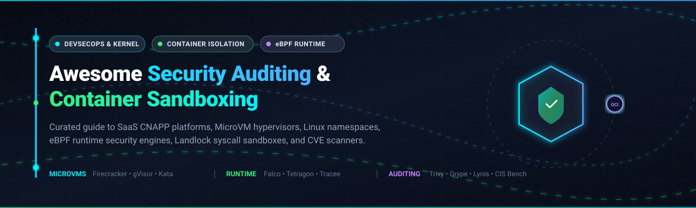

# 🛡️ Awesome Security Auditing & Container Sandboxing 📦

<p align="center">
  
</p>

<p align="center">
  <a href="https://github.com/ishandutta2007/Awesome-Awesome-Awesome"></a>
  <a href="https://discord.gg/jc4xtF58Ve"></a>
  <a href="https://github.com/ishandutta2007/Awesome-Security-Auditing-Container-Sandboxing/stargazers"></a>
  <a href="https://github.com/ishandutta2007/Awesome-Security-Auditing-Container-Sandboxing/network/members"></a>
  <a href="LICENSE"></a>
  <a href="https://github.com/ishandutta2007/Awesome-Awesome-Awesome"></a>
  <a href="https://github.com/ishandutta2007"></a>
</p>

A curated directory and comparative guide of **Enterprise SaaS Cloud-Native Security Platforms (CNAPP)** and **Open-Source Container Sandboxing & Security Auditing Solutions**. This repository covers everything needed to build, isolate, and audit modern compute workloads—from multi-tenant Kubernetes clusters and Linux kernel namespaces to lightweight MicroVMs, eBPF-driven runtime threat mitigation, Landlock LSM boundaries, and automated SBOM/CVE vulnerability scanning.

---

## 📑 Table of Contents

- [📊 Sector Overview & Market Dynamics](#-sector-overview--market-dynamics)
- [☁️ SaaS/Hosted Platforms](#️-saashosted-platforms)
- [💻 Open-Source GitHub Projects](#-open-source-github-projects)
- [🏗️ Architectural Patterns & Selection Guide](#️-architectural-patterns--selection-guide)
- [🤝 How to Contribute](#-how-to-contribute)
- [🌟 Star History](#-star-history)
- [💖 Support](#-support)
- [⚠️ Disclaimer & Security Notice](#️-disclaimer--security-notice)

---

## 📊 Sector Overview & Market Dynamics

The global container security and cloud-native security market is estimated at **$3.06B to $3.89B in 2026** (projected to reach over **$15B–$25B by the early 2030s** at a CAGR of 18–26%), driven by mandatory software bill-of-materials (SBOM) compliance, AI agent code-execution sandboxing demands, and rapid zero-trust cloud transitions. The sector is **moderately fragmented and currently undergoing strong platform consolidation**, transitioning from standalone point-tools (isolated vulnerability scanners or runtime sensors) into comprehensive, winner-take-most Cloud-Native Application Protection Platforms (CNAPP) led by established cybersecurity conglomerates and hyper-growth unicorns.

---

## ☁️ SaaS/Hosted Platforms

The following SaaS and hosted platforms provide managed container security auditing, runtime protection, vulnerability lifecycle management, and microVM cloud sandboxes. Sorted by company scale (valuation / market capitalization in descending order):

| Platform | Valuation / Company Scale | Starting Tier Pricing | Free Tier / Free Trial Limits | Key Capabilities |
| :--- | :--- | :--- | :--- | :--- |
| **[Prisma Cloud](https://paloaltonetworks.com)** | **~$260B Market Cap** *(Palo Alto Networks)* | **$90 – $108 / credit / year** (credit-based licensing blocks; e.g. ~$9,000–$10,800/yr starting baseline) | **30-day full feature trial** (full access to CSPM, vulnerability scanning, and container defense modules across AWS/GCP/Azure) | Enterprise CNAPP suite providing container image compliance, runtime defense, WAAS, Kubernetes posture management, and serverless auditing. |
| **[Wiz](https://wiz.io)** | **$32B Valuation** *(Acquired by Google)* | **~$15,000 / year** (starting workload-based baseline tier in marketplace; enterprise median ~$150k+/yr) | **14 to 30-day managed Proof-of-Concept (PoC)** (full agentless environment scan of cloud workloads, containers, and attack paths) | Complete agentless CNAPP platform delivering deep Kubernetes visibility, CVE scanning, secrets discovery, attack path analysis, and eBPF runtime defense. |
| **[Snyk Container](https://snyk.io)** | **~$7.4B Valuation** *(Dec 2022 Series G)* | **$25 / contributing dev / month** (*Team* plan, billed monthly) | **Free forever plan: 100 container tests / month** (plus 400 SCA tests, 100 SAST tests, up to 10,000 monitored projects) | Developer-centric container and Kubernetes security platform analyzing Dockerfiles, OS packages, and app vulnerabilities with automatic base-image upgrade advice. |
| **[Sysdig Secure](https://sysdig.com)** | **$2.5B Valuation** *(Series G)* | **$1,440 / host / year** (starting AWS Marketplace entry; ~$120/host/month equivalent) | **30-day self-service free trial** (unlimited evaluation of Falco-powered runtime threat detection, image scanning, and posture compliance) | Real-time container security and forensics built on Falco and eBPF, featuring instant syscall-level threat detection, runtime vulnerability prioritization, and compliance scanning. |
| **[Docker Scout](https://docker.com)** | **~$2.1B Valuation** *(Series C)* | **$9 / month** (*Docker Pro*, billed annually; or $15/user/month for *Docker Team*) | **Free forever plan: 1 Docker Scout-enabled repo** (unlimited local image analysis via Docker Desktop/CLI for personal users) | Hosted supply-chain analysis and automated CVE evaluation integrated directly into Docker Hub and Docker Desktop with continuous base-image fix recommendations. |
| **[Aqua Security](https://aquasec.com)** | **$1B+ Valuation** *(Series E Unicorn)* | **~$1,500 – $3,000 / month** (entry-level cloud workload licensing; custom annual enterprise contracts) | **14-day assisted enterprise trial** (evaluate Trivy enterprise scanner, dynamic threat analysis, and eBPF runtime defenses) | Full-lifecycle cloud-native security platform securing container build pipelines, registries, Kubernetes clusters, and cloud workloads with eBPF runtime protection. |
| **[Fly.io Machines](https://fly.io)** | **~$467M Valuation** *(Series D, $115M raised)* | **$5 / month** (usage-based beyond waiver allowance; ~$0.0000008/sec or ~$2.19/mo per 256MB microVM) | **Free forever plan: $5 free credit allowance / month** (equivalent to running up to 3 shared-CPU 256MB RAM Firecracker MicroVMs for small apps) | Hardware-virtualized application platform executing Docker containers inside ultra-fast Firecracker MicroVMs close to users with multi-tenant kernel boundaries. |
| **[E2B](https://e2b.dev)** | **~$100M+ Valuation** *(Series A, $35M raised)* | **$150 / month base** (*Pro* plan, plus per-second microVM CPU/RAM usage billing) | **Free forever plan: $100 one-time usage credits** (1 vCPU, 512MB RAM, max 10 concurrent sandboxes, 1-hour session limit per sandbox) | Hosted Firecracker MicroVM cloud sandbox API designed specifically for isolating untrusted AI agent code execution, automated browsers, and ephemeral workloads. |

---

## 💻 Open-Source GitHub Projects

Sorted by GitHub community popularity (stargazers count descending). Each open-source project features its live GitHub stargazers badge linking directly to its stargazer community.

| Project & Repository | GitHub_Stars | Category / Focus | Description |
| :--- | :--- | :--- | :--- |
| **[Trivy](https://github.com/aquasecurity/trivy)** | [](https://github.com/aquasecurity/trivy/stargazers) | Vulnerability & SBOM Scanner | Comprehensive open-source vulnerability, misconfiguration, secret, and SBOM scanner for container images, filesystems, Git repositories, and Kubernetes clusters. |
| **[Firecracker](https://github.com/firecracker-microvm/firecracker)** | [](https://github.com/firecracker-microvm/firecracker/stargazers) | MicroVM Hypervisor | Minimalist Virtual Machine Monitor (VMM) written in Rust on Linux KVM to create fast, hardware-isolated, multi-tenant microVMs powering AWS Lambda and Fargate. |
| **[gVisor](https://github.com/google/gvisor)** | [](https://github.com/google/gvisor/stargazers) | Userspace Application Kernel | Google's Go-based application kernel implementing the Linux system interface in userspace, providing strong OCI container isolation (`runsc`) without VM overhead. |
| **[Lynis](https://github.com/CISOfy/lynis)** | [](https://github.com/CISOfy/lynis/stargazers) | Host & OS Security Auditing | Battle-tested security auditing and compliance hardening tool for Linux, macOS, and Unix hosts supporting container engines; automates CIS, HIPAA, and ISO27001 checks. |
| **[Grype](https://github.com/anchore/grype)** | [](https://github.com/anchore/grype/stargazers) | Image Vulnerability Scanner | Fast, reliable CLI vulnerability scanner by Anchore for container images and filesystems, natively ingesting Syft SBOMs to flag CVEs. |
| **[Kubescape](https://github.com/kubescape/kubescape)** | [](https://github.com/kubescape/kubescape/stargazers) | Kubernetes Security Platform | CNCF open-source platform offering NSA-CISA/MITRE compliance auditing, RBAC risk visualization, image vulnerability triage, and eBPF reachability analysis. |
| **[Clair](https://github.com/quay/clair)** | [](https://github.com/quay/clair/stargazers) | Registry Vulnerability Engine | Static analysis engine by Red Hat / Quay for vulnerability scanning of app container images at the container registry layer. |
| **[Syft](https://github.com/anchore/syft)** | [](https://github.com/anchore/syft/stargazers) | SBOM Generator CLI | CLI tool and Go library by Anchore for generating comprehensive Software Bills of Materials (SPDX, CycloneDX) from container images and filesystems. |
| **[Docker Bench for Security](https://github.com/docker/docker-bench-security)** | [](https://github.com/docker/docker-bench-security/stargazers) | CIS Benchmark Auditor | Official POSIX script that audits production Docker daemon and host configurations against the official CIS Docker Benchmark standards. |
| **[Falco](https://github.com/falcosecurity/falco)** | [](https://github.com/falcosecurity/falco/stargazers) | eBPF Runtime Detection | CNCF graduated de-facto standard cloud-native runtime security monitor using eBPF and kernel modules to detect unauthorized syscalls, root escalations, and zero-days. |
| **[Bubblewrap](https://github.com/containers/bubblewrap)** | [](https://github.com/containers/bubblewrap/stargazers) | Unprivileged Linux Sandbox | Low-level unprivileged sandboxing utility using Linux user namespaces, bind mounts, and seccomp filters; core engine behind Flatpak and local AI code sandboxes. |
| **[Kata Containers](https://github.com/kata-containers/kata-containers)** | [](https://github.com/kata-containers/kata-containers/stargazers) | MicroVM OCI Runtime | Open-source container runtime seamlessly building lightweight virtual machines that feel and integrate like standard OCI containers with hardware kernel isolation. |
| **[kube-bench](https://github.com/aquasecurity/kube-bench)** | [](https://github.com/aquasecurity/kube-bench/stargazers) | Kubernetes CIS Auditor | Go-based auditing tool that verifies whether Kubernetes master and worker nodes are deployed according to CIS Kubernetes Benchmark best practices. |
| **[Firejail](https://github.com/netblue30/firejail)** | [](https://github.com/netblue30/firejail/stargazers) | SUID Application Sandbox | Security sandbox program reducing the risk of security breaches by restricting the running environment of untrusted Linux desktop apps and server processes. |
| **[Youki](https://github.com/youki-dev/youki)** | [](https://github.com/youki-dev/youki/stargazers) | Rust OCI Container Runtime | High-performance OCI container runtime written in Rust featuring memory safety, fast execution, and modern Linux cgroup v2 / seccomp containment. |
| **[Sandbox Runtime (srt)](https://github.com/anthropics/sandbox-runtime)** | [](https://github.com/anthropics/sandbox-runtime/stargazers) | OS-Level Agent Sandbox | Anthropic's lightweight sandboxing tool enforcing filesystem and network restrictions on arbitrary CLI commands at the OS level without heavy container engines. |
| **[Cosign](https://github.com/sigstore/cosign)** | [](https://github.com/sigstore/cosign/stargazers) | Container Image Signing | Sigstore's container signing, verification, and storage tool in OCI registries, securing container supply chains against tampering. |
| **[Cilium Tetragon](https://github.com/cilium/tetragon)** | [](https://github.com/cilium/tetragon/stargazers) | Kernel eBPF Enforcement | eBPF-based security observability and real-time runtime enforcement tool capable of intercepting and synchronously terminating malicious system calls in-kernel. |
| **[Tracee](https://github.com/aquasecurity/tracee)** | [](https://github.com/aquasecurity/tracee/stargazers) | eBPF Threat Forensics | Aqua Security's runtime security and behavioral tracing engine using eBPF to detect suspicious process activity, memory alterations, and fileless malware. |
| **[OPA Gatekeeper](https://github.com/open-policy-agent/gatekeeper)** | [](https://github.com/open-policy-agent/gatekeeper/stargazers) | Admission Policy Controller | Validating and mutating webhook admission controller that enforces Open Policy Agent (OPA) CRD-based governance policies across Kubernetes clusters. |
| **[crun](https://github.com/containers/crun)** | [](https://github.com/containers/crun/stargazers) | C OCI Runtime | Extremely fast, lightweight OCI container runtime written in C with native support for systemd, rootless cgroups, Landlock, and seccomp filters. |
| **[nsjail](https://github.com/google/nsjail)** | [](https://github.com/google/nsjail/stargazers) | Process Isolation Sandbox | Google's process isolation sandbox leveraging Linux namespaces, cgroups, `rlimits`, and `kafel` BPF syscall filters to constrain untrusted programs and CTF challenges. |
| **[Sysbox](https://github.com/nestybox/sysbox)** | [](https://github.com/nestybox/sysbox/stargazers) | Rootless Nested Container Runtime | Advanced OCI runtime enabling rootless containers to execute system-level workloads (systemd, Docker-in-Docker, KinD) with strong user namespace boundaries. |
| **[Dockle](https://github.com/goodwithtech/dockle)** | [](https://github.com/goodwithtech/dockle/stargazers) | Container Image Linter | Security linter for container images checking for CIS Docker benchmarks, root-user execution, credentials leaks, and unnecessary permissions. |
| **[Landrun](https://github.com/Zouuup/landrun)** | [](https://github.com/Zouuup/landrun/stargazers) | Landlock CLI Sandbox | Lightweight Go CLI utility that leverages Linux Landlock LSM to execute arbitrary processes inside an unprivileged sandbox with strict filesystem and TCP policies. |
| **[RootlessKit](https://github.com/rootless-containers/rootlesskit)** | [](https://github.com/rootless-containers/rootlesskit/stargazers) | Rootless Container Tooling | Linux-native user namespace "fake root" tool powering rootless Docker, Podman, and containerd without requiring root daemon privileges. |
| **[Bane](https://github.com/genuinetools/bane)** | [](https://github.com/genuinetools/bane/stargazers) | AppArmor Profile Generator | Custom, fine-grained AppArmor profile generator designed specifically to harden Docker containers and restrict privileged syscall abuse. |

---

## 🏗️ Architectural Patterns & Selection Guide

When architecting a secure containerized environment, defense-in-depth requires combining multiple isolation and auditing layers:

```
+-----------------------------------------------------------------------------------+
|  1. BUILD & SUPPLY CHAIN SECURITY                                                 |
|     Syft (SBOM generation) --> Trivy / Grype (CVE scan) --> Cosign (Sign Image)   |
+-----------------------------------------------------------------------------------+
                                         |
                                         v
+-----------------------------------------------------------------------------------+
|  2. ADMISSION CONTROL & POSTURE AUDITING                                          |
|     OPA Gatekeeper / Kyverno (Policies) + kube-bench / Lynis (CIS Hardening)     |
+-----------------------------------------------------------------------------------+
                                         |
                                         v
+-----------------------------------------------------------------------------------+
|  3. WORKLOAD ISOLATION & SANDBOX RUNTIME                                          |
|     Standard Apps:      crun / Youki / Sysbox (Rootless Namespaces + Seccomp)    |
|     Untrusted / AI:     gVisor (Userspace Kernel) OR Firecracker / Kata (MicroVM)|
|     CLI Commands:       Bubblewrap / Landrun / Anthropic Sandbox Runtime (OS LSM)|
+-----------------------------------------------------------------------------------+
                                         |
                                         v
+-----------------------------------------------------------------------------------+
|  4. RUNTIME THREAT DETECTION & ENFORCEMENT                                        |
|     Falco / Cilium Tetragon / Tracee (eBPF In-Kernel Syscall Tracing & Kill)      |
+-----------------------------------------------------------------------------------+
```

- 🤖 **For Multi-Tenant AI Agent Execution**: Utilize **Firecracker** or **gVisor (`runsc`)** to isolate untrusted code execution from the host kernel.
- 🔒 **For Low-Overhead Process Isolation**: Use **Bubblewrap** or **Landrun** (Landlock LSM) to enforce path allowlists and disable unauthorized network egress.
- 🔍 **For Production CI/CD Pipelines**: Run **Trivy** or **Grype + Syft** on every pull request, enforcing zero Critical/High CVE deployments.
- ⚡ **For In-Cluster Threat Blocking**: Deploy **Cilium Tetragon** with eBPF sensor rules to terminate malicious processes in-kernel before syscall execution completes.

---

## 🤝 How to Contribute

Contributions to this ecosystem guide are warmly welcomed! To suggest a new tool or update an existing entry:

1. **Fork the repository** to your personal GitHub account.
2. **Add or modify entries** in `README.md`:
   - For SaaS tools: include verified starting tier pricing, explicit free trial/tier limits, company valuation/scale, and key capabilities.
   - For Open-Source projects: follow the table schema with proper repository links and stargazer badges `[](https://github.com/owner/repo/stargazers)`.
3. Ensure tools are placed in the correct sorted order (SaaS by company valuation descending, OSS by GitHub_Stars descending).
4. **Submit a Pull Request** with a brief summary explaining why the project is a valuable addition.

---

## 🌟 Star History

[](https://star-history.dera.page/#ishandutta2007/Awesome-Security-Auditing-Container-Sandboxing&type=date&legend=top-left)
[](https://www.star-history.com/#ishandutta2007/Awesome-Security-Auditing-Container-Sandboxing&type=date&legend=top-left)

---

## 💖 Support

Thank you for visiting and supporting the **Awesome Security Auditing & Container Sandboxing** project! 🙌

If you find this curated directory helpful for your security research, platform engineering, or container hardening efforts, please consider:
- ⭐ **Starring this repository** to help others discover it
- 🍴 **Forking and contributing** your favorite tools and insights
- 📢 **Sharing it** with your fellow DevSecOps engineers and communities
- ☕ **Buying a coffee / sponsoring** the maintainer on the [GitHub Sponsor Dashboard](https://github.com/sponsors/ishandutta2007)

Your support keeps this project maintained, up to date, and free for the open-source community! ❤️

---

## ⚠️ Disclaimer & Security Notice

- This repository is a **community-curated index** provided for educational, research, and platform architectural purposes. Mention of a tool or platform does not constitute an official endorsement.
- Container sandboxing mechanisms (`namespaces`, `seccomp`, `gVisor`, `Firecracker`) differ substantially in their attack surfaces and security guarantees. A defense-in-depth model—incorporating least privilege, read-only root filesystems, rootless execution, drop capabilities (`CAP_SYS_ADMIN`), and network segmentation—remains essential.
- Automated security scanners and auditing tools (`Lynis`, `docker-bench-security`, `Falco`) should only be executed against cloud environments, hosts, clusters, and registries that you own or have explicit authorization to audit.

---

<p align="center">
  <b>Built with care for DevSecOps engineers, platform architects, security researchers, and systems developers.</b><br>
  <i>Empowering resilient, verifiable, and secure container sandboxing for everyone.</i>
</p>
